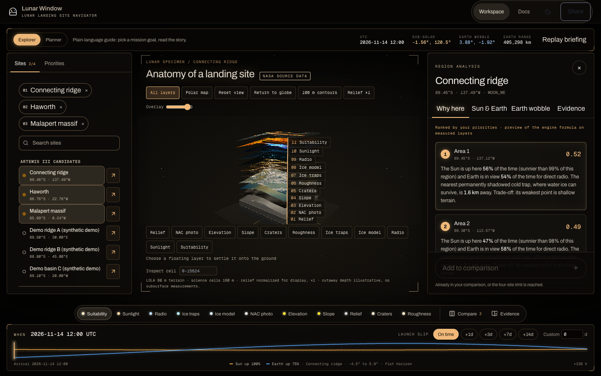

# Lunala mission control

## Run and explore

`cd web && pnpm install --frozen-lockfile && pnpm exec vite --host 127.0.0.1 --port 55050`

Open `/app`, choose a globe region or its inspect arrow, then select a floating layer to settle it
onto the real LOLA terrain. Drag to orbit, scroll/pinch to zoom, reset, reopen All layers, or Return
to globe. Polar map reuses PR #118's real terrain renderer. Reduced motion skips travel, hidden scenes
pause, and cursor-wave displacement never changes scientific results.

## Before → after / transfer guide

| Before | After | Code |
|---|---|---|
| Host imported a removed DotField export | Real assets load into the exploded specimen | `web/src/features/heatmap/HoloStage.tsx` |
| Flat dot preview disconnected from terrain | Layer docking, orbit/zoom, relief, map, opacity, contours | `web/src/features/heatmap/StrataView.tsx` |
| Downward triangles; coarse cells stretched to tile edges | Upward normals, projected registration and edge-aware probes | `web/src/features/heatmap/specimen.ts` |
| Hard-coded green shell | Warm ivory/amber theme with scientific palettes | `web/src/shell/theme.css` and mission/analysis/hologram/tour CSS |
| Covered custom points had no science | Resolve coverage while retaining clicked coordinates | `web/src/shell/Navigator.tsx` |
| Legacy saved records lacked required defaults | Migration and preserved layer/playhead/delay/priorities | `web/src/scenarios/store.ts` |
| One grid failure discarded every region | Partial availability and explicit retry | `web/src/features/mission/useMissionData.ts` |
| PSR was the only ice-related layer | Separate native-591 m USGS geologic IFI model | `pipeline/src/lunar_pipeline/terrain/science.py` |

Use the delivered unified patch against its matching base for a live-codebase transfer; copying only
the renderer misses persistence, contracts, assets and caller changes. No Rust or worker API is changed.

## Scientific contract and regeneration

Optional scalar float32 fraction layers: `sun_avg`, `earth_avg`, `psr`, `ice_favorability`.
The first three are long-term PGDA 69 products, not launch-date results. IFI is a geologic model,
not detected ice or concentration. Native resolution is 591 m; nearest-neighbour reprojection from
its own CRS adds no finer information. Missing IFI samples use sentinel -9999. PSR distance remains
the separate, explicitly labelled ice-access preview factor.

Run `cd pipeline && uv run --frozen python -m lunar_pipeline science`, then
`uv run --frozen python -m lunar_pipeline package`. Run `cd contracts && pnpm gen` after schema edits.
Sources are checksum-pinned; raw TIFFs remain ignored. The output manifest records sources, hashes and
sizes (about 10.2 MB against the 25 MB budget). Source nodata is masked before scaling. PGDA aggregation
uses source-pixel centres; it does not claim exact fractional-area integration. North-up source rasters
are converted to the contract's row-increasing projected +y convention.

References: [PGDA 69](https://pgda.gsfc.nasa.gov/products/69),
[USGS IFI](https://astrogeology.usgs.gov/search/map/moon_ice_favorability_index_south_pole_591mp).

## Attack summary → tests → gap analysis → gap tests

1. Wrong-location overlays can look convincing: reversed rows, stretched extents, downward normals or
   edge rounding can silently corrupt a probe.
2. Stale requests and old saved records can overwrite location/layer identity or advertise unavailable data.
3. Camera animation, loading veils and narrow/tour layouts can trap interaction despite a rendered canvas.

Tests: `specimen.test.ts`, `specimen.browser.ts`, `scene.browser.ts`, `shell.browser.ts`,
`tour.browser.ts`, scenario-store tests, and `pipeline/tests/test_science.py`.

Centred-only tests leave row reversal and edge shifts undetected. Gap tests check all corners, invalid
probes, original measured heights and outward normals. Screenshot-only tests can pass without numerical
correctness: WebGL-disabled tests read real source values, delayed-request tests assert selected identity,
and missing-imagery tests assert disabled/unavailable state. Raster fixtures explicitly separate north
from south and exercise nodata before scaling. Browser acceptance must also exercise actual GPU rendering.

## Ownership and limitations

Ananth retains physics, horizon masks, workers, date-specific scores, thermal outputs and determinism
hashing. TypeScript suitability is an explicitly labelled preview over long-term layers; synthetic
engine fixtures remain labelled. Astronomy Engine geometric positions are checked against Horizons
samples, but a flat horizon is not terrain-aware visibility. Terrain relief is normalized for display;
cutaway depth is illustrative, with no measured subsurface geology. Local visual shadows do not cover
the full 150 km scientific horizon domain. Measured panorama obstruction awaits the engine's masks.

Initial implementation stayed local. The user subsequently approved publishing and merging this work;
branch renaming, unrelated rewrites, and the Higgsfield video remain out of scope.

## Checklist

- [x] Read spec, proposal, quality bar, plans/transcripts and merged PR #118.
- [x] Preserve branch and prior uncommitted work; reuse shipped regions and helpers.
- [x] Validate shapes, layout, identity, units, projection, finite values and provenance.
- [x] Keep shaders visual-only and raw data out of git; document regeneration and dependencies.
- [x] Final browser acceptance and measurements, recorded below.
- [x] User approved the interactive preview and requested publication and merge.

## Verification

- Frontend: typecheck, lint and production build pass; 142 unit tests pass.
- Contracts: 93 tests pass; generated types are current; 29 data/header/manifest files validate.
- Pipeline: 216 tests pass; changed Python files pass ruff. One existing imagery-fixture
  NotGeoreferencedWarning is expected for a synthetic test raster.
- Browser: 11 applicable tests passed in the full production-preview run; its two landing failures
  were fixed and both passed on recheck. All 13 applicable tests therefore pass. Two development-only
  design-reference tests are skipped on production builds. Landing checks include axe contrast;
  mission checks include desktop/mobile axe, navigation, history, fallback, stale responses and retry.
- Screenshots (local-only, not in the repo): `.context/qa/terrain-desktop.png`, `terrain-nac.png`, `terrain-mobile.png`,
  `moon-overview.png`. Screenshot run reported zero page exceptions. Chrome used SwiftShader and
  reduced motion; native M1 60 fps and normal-motion hardware timing remain unverified.
- Three-region preview ranking: 20 local Node runs, median 4.56 ms, maximum 16.14 ms; factors cached,
  scoring plus greedy selection included. Initial JS entry: about 122 KB gzipped; 3D loads lazily.
  Vite reports large optional 3D chunks and existing ignored dependency `use client` directives.
- Preview: `http://127.0.0.1:55050/`, served from the checked production build.

The copyable `.context/lunar-window.patch` (local-only, not in the repo) includes the interrupted work and this continuation relative
to base `e23ab634558e957c4642fdaa6d40e0efbdfc4c58`. It includes binary grid changes and added files;
review it against that base before applying elsewhere. Publication was authorized after visual approval.

## Review image

